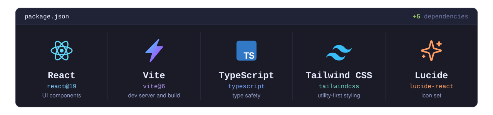
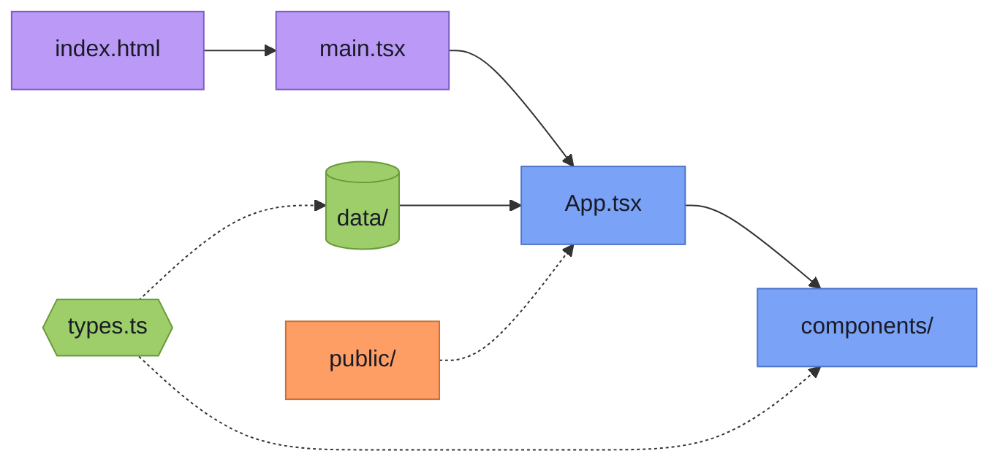
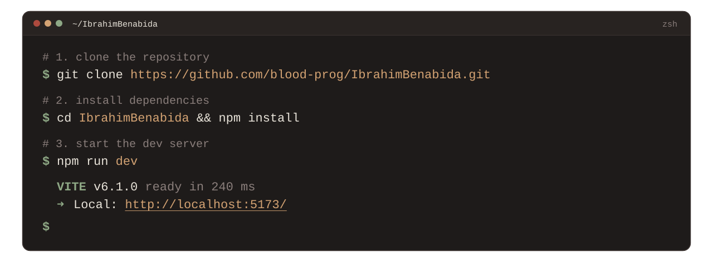
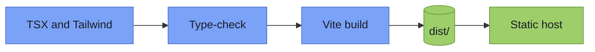
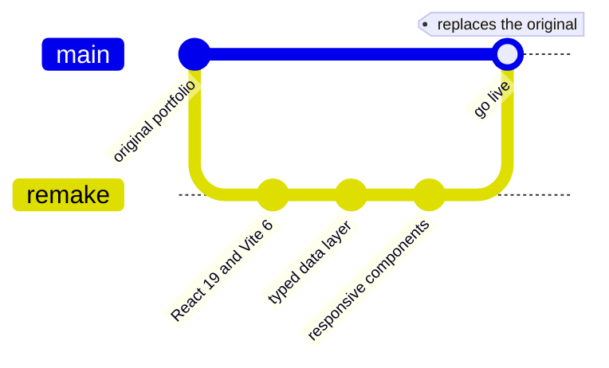

<div align="center">



<br />
<br />

**[overview](#overview)** &nbsp;/&nbsp; **[stack](#the-stack)** &nbsp;/&nbsp; **[structure](#project-structure)** &nbsp;/&nbsp; **[quick start](#quick-start)** &nbsp;/&nbsp; **[customize](#customize-it)** &nbsp;/&nbsp; **[deploy](#deploy-it)** &nbsp;/&nbsp; **[roadmap](#roadmap)** &nbsp;/&nbsp; **[license](#license)**

<br />

[](LICENSE)
[](https://github.com/blood-prog/IbrahimBenabida/commits)
[](https://github.com/blood-prog/IbrahimBenabida/stargazers)


</div>

<br />

> [!IMPORTANT]
> **This is the remake.** It is a ground-up rebuild of my original portfolio, and it is going to **replace the old one**. Everything was rebuilt on a modern stack.

```diff
- original portfolio
+ the remake, built on React 19, Vite 6, TypeScript and Tailwind CSS
+ typed content, modular components, responsive layout
```

<br />

## Overview

This is my personal portfolio: a home for my projects and works, built to be quick to load, comfortable on any screen and easy to keep up to date. The remake is organized around four ideas.

| **Fast** | **Responsive** | **Typed** | **Modular** |
|:--|:--|:--|:--|
| Vite gives instant hot reload while developing and an optimized bundle for production. | Layouts adapt from small phones to wide desktop screens. | TypeScript interfaces describe every project and work in the dataset. | Small components, with content kept apart from layout. |

<!-- Add a real screenshot here once you have one:  -->

<br />

## The stack

<div align="center">

</div>

<details>
<summary><b>Stack details and docs</b></summary>

<br />

| Layer | Technology | Role |
|:--|:--|:--|
| Framework | [React 19](https://react.dev/) | Component-based UI |
| Build tool | [Vite 6](https://vite.dev/) | Dev server, hot reload and production bundling |
| Language | [TypeScript](https://www.typescriptlang.org/) | Type safety across the codebase |
| Styling | [Tailwind CSS](https://tailwindcss.com/) | Utility-first, responsive design |
| Icons | [Lucide React](https://lucide.dev/) | Consistent, crisp SVG icons |

</details>

<br />

## Project structure

Everything in this tree is new in the remake.

```diff
+ IbrahimBenabida/
+ ├── public/              static assets, portfolio imagery and project graphics
+ ├── src/
+ │   ├── components/      modular React UI components
+ │   ├── data/            portfolio projects and works dataset
+ │   ├── App.tsx          main layout and interactions
+ │   ├── main.tsx         application entry point
+ │   └── types.ts         shared TypeScript interfaces
+ ├── docs/assets/         graphics used by this README
+ ├── index.html           HTML entry point
+ ├── package.json         dependencies and scripts
+ ├── tailwind.config.js   Tailwind configuration
+ └── tsconfig.json        TypeScript configuration
```

### How the pieces connect



<sub>Purple is the entry point, blue is the interface, green is content and types, orange is static assets. Dotted lines are supporting relationships.</sub>

<br />

## Quick start

<div align="center">

</div>

Prefer to copy and paste? Here are the same commands:

```bash
git clone https://github.com/blood-prog/IbrahimBenabida.git
cd IbrahimBenabida
npm install
npm run dev
```

You will need **Node.js 18 or newer** and **npm**, **pnpm** or **yarn**. Open the local URL printed in the terminal (Vite uses `http://localhost:5173` by default) and the page reloads as you edit.

### Scripts

| Command | What it does |
|:--|:--|
| `npm run dev` | Starts the development server with hot module replacement |
| `npm run build` | Type-checks the project and creates an optimized production build |
| `npm run preview` | Serves the production build locally so you can test it before deploying |

<details>
<summary><b>Using pnpm or yarn instead?</b></summary>

<br />

```bash
# pnpm
pnpm install
pnpm dev

# yarn
yarn
yarn dev
```

</details>

<details>
<summary><b>Something not working?</b></summary>

<br />

| Problem | Try this |
|:--|:--|
| Install or start fails | Run `node -v` and make sure it prints v18 or higher. |
| Strange errors after switching branches | Delete `node_modules` and your lockfile, then run `npm install` again. |
| Port 5173 is busy | Vite usually picks the next free port. To choose one yourself, run `npm run dev -- --port 3000`. |
| `npm run build` reports type errors | The build type-checks first. Fix the files it lists, and check that your data matches `src/types.ts`. |

</details>

<br />

## Customize it

Content and layout live in different places, so updating the portfolio rarely means touching the UI.

| I want to… | Go to |
|:--|:--|
| Add or edit projects and works | `src/data/` |
| Change the shape of the content | `src/types.ts` |
| Adjust sections, layout or interactions | `src/App.tsx` and `src/components/` |
| Swap images and project graphics | `public/` |
| Change colors, fonts and theme | `tailwind.config.js` |

> [!TIP]
> After you edit the dataset, the TypeScript compiler flags any entry that does not match the interfaces in `src/types.ts`, so mistakes are caught before they reach production.

<br />

## Deploy it

The project builds to plain static files, so any static host will do.



| Setting | Value |
|:--|:--|
| Install command | `npm install` |
| Build command | `npm run build` |
| Output directory | `dist` |

This works out of the box on **Vercel**, **Netlify**, **Cloudflare Pages** and **GitHub Pages**.

> [!NOTE]
> On a GitHub Pages project URL such as `username.github.io/repo`, set the `base` option in your Vite config to the repository name so assets load from the right path.

<br />

## Roadmap

The remake is built. What is left is the switch.

- [x] Rebuild the portfolio on React 19, Vite 6 and TypeScript
- [x] Create a typed dataset for projects and works
- [x] Build modular, responsive components
- [ ] Go live and replace the original portfolio
- [ ] Retire the old site



<sub>The final merge is the part still ahead.</sub>

<br />

## Feedback

Found a bug, or have an idea that would make the portfolio better? [Open an issue](https://github.com/blood-prog/IbrahimBenabida/issues). I read all of them.

<br />

## Credits

Built on the work of the people behind [React](https://react.dev/), [Vite](https://vite.dev/), [TypeScript](https://www.typescriptlang.org/), [Tailwind CSS](https://tailwindcss.com/) and [Lucide](https://lucide.dev/). Thank you.

<br />

## License

Released under the [MIT License](https://github.com/blood-prog/IbrahimBenabida/blob/main/LICENSE).

<br />

<div align="center">

</div>
